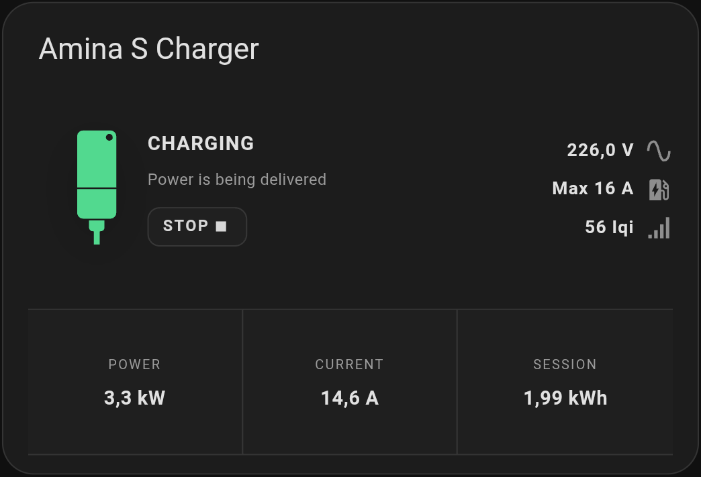
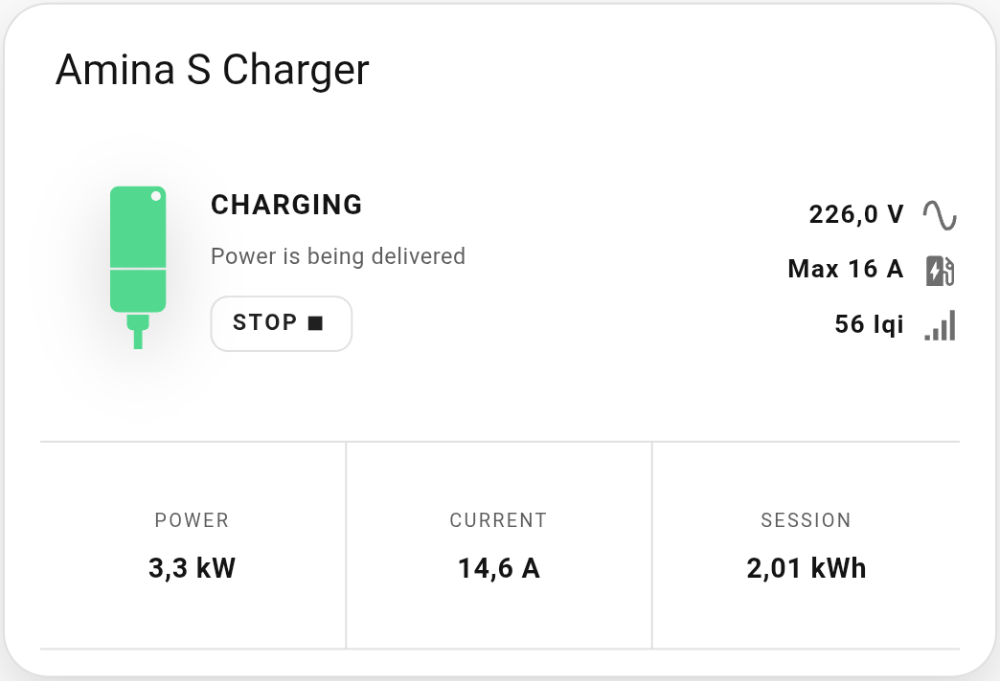

# Amina S Card

A compact Home Assistant dashboard card for Amina S EV chargers using Zigbee2MQTT or ZHA with the [Amina S quirk](https://github.com/attaxia/amina_s_zha_quirk). It shows status, voltage, link quality, charge limit, total power, current, and last-session energy. No template sensors or helpers are needed.

Supports both Zigbee2MQTT and ZHA, with automatic entity discovery and single-phase and three-phase telemetry. ZHA requires installing Attaxia's custom quirk.

<!-- ha-marketplace:exclude-start -->

## Installation

### Marketplace (Home Assistant 2026.11 and later)

[Marketplace](https://contributors.home-assistant.io/marketplace/) is built into Home Assistant. Amina S Card is available in the catalog; no custom repository is needed.

[Open Amina S Card in Marketplace](https://my.home-assistant.io/redirect/marketplace_repository/?owner=bkflatekvaal&repository=ha-amina-s-card&category=plugin)

1. Open **Settings > Marketplace** and search for **Amina S Card**.
2. Open the card's page and install it.
3. Reload your browser, then add **Amina S Card** from the dashboard card picker.

Marketplace adds the dashboard resource automatically. If you manage resources in YAML, add the resource shown in the installation dialog. Reload your browser after updates too.

### Manual file installation

Copy [dist/amina-s-card.js](dist/amina-s-card.js) to `/config/www/amina-s-card/amina-s-card.js` and add this dashboard resource:

```yaml
url: /local/amina-s-card/amina-s-card.js
type: module
```

<!-- ha-marketplace:exclude-end -->

## Setup

Select the charger's EV status entity in the visual editor, or use YAML:

```yaml
type: custom:amina-s-card
status_entity: sensor.amina_s_ev_status
```

- The heading defaults to the device name. Clear an existing **Title** override to use it.
- The card discovers entities on the selected charger's device, with ZHA/MQTT naming fallbacks. Use **Optional override** when needed.
- For ZHA, install the quirk, recreate/check entity IDs, and update the card's selection. See [ZHA setup](docs/zha-setup.md).
- Enable LQI/link quality manually for both integrations. Its row is hidden when disabled or absent. Missing numeric readings show `-`.

## Screenshots

| Dark | Light |
| --- | --- |
|  |  |

See [all screenshots](docs/screenshots.md) for other states and the configuration editor. Screenshots illustrate appearance; readings and headings depend on your setup.

## Documentation

- [Configuration and entity defaults](docs/configuration.md)
- [ZHA setup](docs/zha-setup.md)
- [Power and phase telemetry](docs/phase-telemetry.md)
- [More frequent energy updates using helpers](docs/live-energy.md)
- [Changelog](changelog.md)

## Development

```sh
npm install
npm test
npx tsc --noEmit
npm run build
```

The production bundle is written to `dist/amina-s-card.js`.

See [testing and CI](docs/testing.md) for coverage and remaining manual checks.

## License

[MIT](LICENSE).
